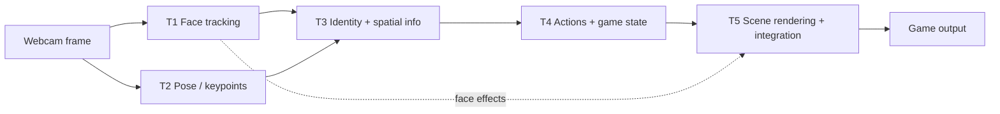

# IPCV Project · Requirements Specification

*Source: [[UT/A1/Image Processing/Project/IPCV_2026-1A_Project_Description_v1.pdf|Project Description v1.0 (12 Sep 2026)]] · Canvas deliverables page · course syllabus*
*Compiled 2 Oct 2026 · Canvas and lecturer announcements override this document if they change.*

> [!abstract] The project in one breath
> Build a **real-time multiplayer game** controlled **only by computer vision** through **one webcam**, for **at least two players at once**.
> Five students, five compulsory technical tasks, **one integrated game**: not five separate demos.
> Worth **60 % of the course**: peer-reviewed video 10 %, live demo 15 %, report + code + poster 15 %, individual questions 20 %.

---

## Team and task owners

| Task | Title | Owner |
|---|---|---|
| T1 | Face tracking and augmented effects | |
| T2 | Body pose estimation and motion tracking | |
| T3 | Multiplayer detection and identity tracking | |
| T4 | Player interaction and game control | |
| T5 | Scene processing and real-time integration · **team leader** | |

> [!warning] The owner names must be identical in the report and in the README (§9 checklist).

---

## Key dates and limits

| What | Value | Source |
|---|---|---|
| Deliverable 1 · peer-review video | due **1 Nov 2026, 23:59** · 10 pts | Canvas |
| Deliverable 2 · final project package | due **1 Nov 2026, 23:59** · 50 pts | Canvas |
| Exhibition (live demo + questions) | **5–6 Nov** (to be confirmed) | syllabus |
| Video | MP4 · ≤ **60 s** · ≤ **100 MB** · one continuous take | §4.1 |
| Technical report | PDF · ≤ **5 main pages** | §4.2.1 |
| Poster | **1 page A4** PDF (A3 if you can print) | §4.2.2 |
| Final ZIP | ≤ **500 MB** | §4.2.3 |
| Live demo | ≤ **3 min** | §7 |
| Individual questions | **5 min in total** for all five students | §7 |
| Late submission | ≤ 2 h late: **−2 points** · > 2 h: **0 points** (general course rule) | syllabus |
| Group registration, approved absence, exhibition details | published on Canvas | §10 |

> [!tip] Implication
> Five minutes for five people is about **one minute each**. Prepare a crisp 30-second explanation of your task's pipeline.

---

## How to read this document

| Code | Meaning |
|---|---|
| **SYS / T1–T5 / DEL / AI / DEMO** | requirement groups: system, tasks, deliverables, AI statement, on-site demo |
| **shall** | mandatory: written in the project description |
| **should** | recommended or derived by us (marked *derived*) |
| **D** · Demonstration | shown working in the video or the live demo |
| **T** · Test | measured: a number goes in the report |
| **I** · Inspection | checked by reading the code, report or README |
| **A** · Analysis | argued with reasoning, e.g. a failure-case discussion |

The **Evidence** column says what we must produce to prove the requirement. The report requires measured results for every task (§4.2.1).

---

## 1 · System requirements

| ID | The system shall… | Verif. | Evidence |
|---|---|---|---|
| SYS-01 | be a real-time, webcam-based **multiplayer game** where physical movements, facial expressions, body poses or gestures become game actions | D | video + live demo |
| SYS-02 | detect and support **at least two players simultaneously using one webcam** | D | two players in frame throughout |
| SYS-03 | use **no other input hardware** (no IMU, no joystick). The controller is CV-based motion tracking and recognition | I, D | — |
| SYS-04 | make player movements produce **visible and meaningful changes** in the game | D | — |
| SYS-05 | run tracking and interaction **continuously in real time**, stable enough for live use | T | FPS / latency (see T5) |
| SYS-06 | make **all five compulsory tasks visible** in the integrated game | D | video shows T1–T5 |
| SYS-07 | integrate the five tasks as **one game**, not as five unrelated demonstrations | D | — |
| SYS-08 | be **tested as a complete system**, with performance and principal failure cases reported | T, A | report section |

**Constraints and allowances**

| ID | Statement |
|---|---|
| SYS-09 | Additional cameras or imaging devices are **allowed but optional**; they do not earn a higher grade by themselves. |
| SYS-10 | Pretrained AI models, libraries, APIs and AI coding agents are **allowed, without penalty**. The group stays responsible for the whole system (see §6). |
| SYS-11 | Real-time optimisation (algorithm, resolution, …) is part of the job: *"careful consideration… instead of complaint about slow PC"*. |
| SYS-12 | Game complexity is **not** the core. Show the IPCV techniques. **Pong is discouraged.** |
| SYS-13 | The display can be effects overlaid on the webcam stream, or a separate game rendering controlled by vision ("vision-based game interfacing", §3.2.7). |
| SYS-14 | All five students **collaborate on interfaces, integration and system testing**. |
| SYS-15 | Each task owner **documents the limitations** and the conditions under which their module does **not** perform reliably (§3.2.6). |

---

## 2 · Task requirements

> [!info] Same structure for every task
> **Main outcome** → requirements table → **required demonstration** → **boundary** (what belongs to another task).
> *Suggested metrics* are our proposal for the "measured evidence" the report demands. They are not in the PDF.

---

### T1 · Face tracking and augmented effects

> [!info] Main outcome
> Smooth, stable, jitter-resistant tracking of **at least two faces** under dynamic conditions, with augmented effects that stay **correctly aligned** and **contribute to the game**.

| ID | T1 shall… | Verif. |
|---|---|---|
| T1-01 | detect **at least two faces simultaneously** | D |
| T1-02 | track the **location, size and relevant orientation** of each face over time | D, T |
| T1-03 | apply **temporal filtering** (or another suitable method) to reduce visible jitter | T |
| T1-04 | attach **at least one augmented effect to each tracked face** | D |
| T1-05 | keep the effect **aligned** when the player moves, turns, or changes distance from the camera | D |
| T1-06 | **prevent effects from switching** between players | D, T |
| T1-07 | handle **short detection failures or partial occlusion** in a controlled way, including partially leaving the frame | D |
| T1-08 | add **one extra visual effect, different from the face effect**, showing game state (name), player feedback (buffs) or player condition (HP, MP) | D |
| T1-09 | give the effect a **meaningful role in the game**, not a static decoration at a fixed image position | D |

> [!example] Required demonstration
> Two players **moving dynamically** while their face effects stay smooth, stable, correctly aligned and attached to the right player.

*Suggested metrics:* face detection rate (% of frames) · jitter of the effect anchor when the head is still (px std) with vs. without filter · effect-switch count per minute · module time per frame (ms).

---

### T2 · Body pose estimation and motion tracking

> [!info] Main outcome
> Smooth, responsive body-pose estimates and motion signals usable as **reliable player or object control inputs**.

| ID | T2 shall… | Verif. |
|---|---|---|
| T2-01 | **select** the body parts, limbs, hands, poses or movements the game needs | I |
| T2-02 | estimate the relevant **keypoints for every detected player** | D |
| T2-03 | **convert keypoints into motion or control signals** | D |
| T2-04 | apply **temporal filtering, smoothing or prediction** to reduce jitter | T |
| T2-05 | use **confidence values** (or another method) to identify unreliable keypoints | I, T |
| T2-06 | handle **temporarily missing keypoints without uncontrolled game actions** | D |
| T2-07 | **balance smoothness against responsiveness**: filtering must not add excessive delay | T |
| T2-08 | **evaluate module-level responsiveness and stability** during realistic movement | T |

> [!example] Required demonstration
> The selected movements are detected **continuously** and turned into **stable control signals**. Show what happens when keypoints become **uncertain or disappear** for a moment.

> [!note] Boundary
> T2 decides **where** body parts are and how they move. **Who** they belong to is T3.

*Suggested metrics:* keypoint jitter (px std, raw vs. filtered) · added filter delay (ms or frames) · % frames with low-confidence keypoints · false control signals during dropouts · module time per frame.

---

### T3 · Multiplayer detection and identity tracking

> [!info] Main outcome
> At least two simultaneous players with **persistent identities** (Player 1, Player 2) for the whole game, plus **spatial information per player** for T4.

| ID | T3 shall… | Verif. |
|---|---|---|
| T3-01 | **detect and manage at least two players** simultaneously | D |
| T3-02 | assign a **persistent identity** to each player | D |
| T3-03 | **associate each face, body pose and control signal** with the correct identity (in 2D or even 3D) | D |
| T3-04 | **prevent controls, scores or effects from switching** between players | D, T |
| T3-05 | **maintain identities** when players move or **cross positions** | D, T |
| T3-06 | handle **partial occlusion and temporary detection loss** | D |
| T3-07 | define **controlled behaviour when a player leaves and later re-enters** the frame | D, I |
| T3-08 | provide each player's **spatial information to T4**: x–y location, preferably in **physical units rather than pixels**, optionally **depth** | I |
| T3-09 | **assess the reliability** of that derived spatial information (2D or 3D) | T |
| T3-10 | **evaluate** identity consistency, identity switches, recovery behaviour and module-level real-time performance | T |

> [!example] Required demonstration
> Two players **moving and crossing** or **partially occluding** each other. Identities, controls, scores and effects stay with the correct player.

> [!note] Boundary
> T3 decides **who** each face, pose and signal belongs to. Producing smooth keypoints is T2.

*Suggested metrics:* identity switches per crossing (over N trials) · recovery time after occlusion (s) · re-entry correct-ID rate · position error in physical units vs. a measured reference (if calibrated) · module time per frame.

> [!tip] Physical units
> Getting x–y in cm (or depth) needs camera calibration, a known reference size, or a depth model. This links to the *camera calibration & ArUco* tutorial and the *Depth-Anything / MiDaS* tutorial.

---

### T4 · Player interaction and game control

> [!info] Main outcome
> Tracked actions become **reliable game commands**, **meaningful multiplayer interaction** and **clear visual feedback**. Real-world objects may be used, e.g. *apple near the mouth → HP or MP up*.

| ID | T4 shall… | Verif. |
|---|---|---|
| T4-01 | define **clear mappings** from recognised player actions to game commands | I |
| T4-02 | implement **at least two distinguishable actions per player** | D, T |
| T4-03 | include **meaningful player–player or player–object interaction** | D |
| T4-04 | use **temporal or state-based logic** to prevent accidental repeated actions | D, T |
| T4-05 | define suitable **thresholds, cooldowns or action-confirmation rules** | I |
| T4-06 | **update the game state correctly for each identified player** | D |
| T4-07 | add **visual feedback** that clearly shows recognised actions and their consequences | D |
| T4-08 | **align** body- or gesture-related effects with the right player or scene location | D |
| T4-09 | handle **simultaneous or conflicting actions** from different players | D, T |

> [!example] Required demonstration
> **Both players control the game through physical actions**, and the gameplay is consistent, understandable and responsive.

> [!note] Boundary
> Face augmentation is T1. T4 may add **body, gesture, action or game** effects.

*Suggested metrics:* action recognition accuracy (confusion matrix over N attempts per action) · false triggers per minute while idle · action-to-feedback latency (ms) · outcome when both players act in the same frame.

---

### T5 · Scene processing and real-time integration · team leader

> [!info] Main outcome
> All components integrated into **one complete, responsive, tested, real-time multiplayer game** with a **dynamic visual environment**.

| ID | T5 shall… | Verif. |
|---|---|---|
| T5-01 | act as **team leader**: coordinate tasks 1–4 and **specify the requirements** for T1–T4 | I |
| T5-02 | **integrate all five tasks into one executable application**, including all available team work | D, I |
| T5-03 | **render or process a game environment or background** | D |
| T5-04 | **modify the scene in response to T4 actions**, e.g. background replacement, environmental or impact effects, moving objects, lighting changes, obstacles | D |
| T5-05 | **synchronise** webcam processing, player states, game logic and rendering | D, I |
| T5-06 | **measure end-to-end frame rate or latency** under normal gameplay | T |
| T5-07 | **identify the main computational bottlenecks** | T, A |
| T5-08 | **improve performance** where needed to keep gameplay responsive | T |
| T5-09 | **test the complete game with at least two players** | T |
| T5-10 | handle **uncertain tracking, temporary player loss, invalid actions and module failures** in a controlled way | D |

> [!example] Required demonstration
> The complete game running **continuously in real time**: two-player interaction, responsive scene changes, stable game states, and controlled behaviour during **at least one difficult tracking condition**.

> [!note] Boundary
> T5 owns **end-to-end** behaviour. Module-level pose stability is T2; identity consistency is T3.

*Suggested metrics:* end-to-end FPS (mean, min) and latency (ms) during real gameplay · per-module time breakdown (profiling table) · before/after optimisation numbers · behaviour log for each failure scenario.

---

## 3 · Interfaces between tasks *(derived)*

The PDF assigns these boundaries but leaves the data contracts to T5 (T5-01). A starting point:

| From → To | Data (proposal) |
|---|---|
| T1 → T3 | per face: bbox, landmarks, head orientation, confidence |
| T2 → T3 | per person: smoothed keypoints, per-keypoint confidence, motion signals (velocity…) |
| T3 → T4 | per **Player ID**: position (physical units if available), depth (optional), face + pose + signals, tracking status (ok / lost / re-entered) |
| T4 → T5 | game state (HP/MP, score, …), triggered actions + location, effects to draw |
| T5 → all | frame timestamp, target FPS and time budget per module |

---

## 4 · Deliverables

Two Canvas **group** assignments. **One member submits for the whole group.**

### DEL-1 · Peer-review video (Deliverable 1)

| ID | Requirement |
|---|---|
| DEL-1.1 | MP4, **≤ 60 s**, **≤ 100 MB** |
| DEL-1.2 | **One continuous, unedited take**: no cuts, speed changes or hidden transitions |
| DEL-1.3 | **Webcam input and the corresponding game output** both visible |
| DEL-1.4 | **All five compulsory tasks** demonstrated within the 60 s |
| DEL-1.5 | A short title or game concept may be included, but it is **not a presentation** |
| DEL-1.6 | Submitted **before the 2-day exhibition** (Canvas due date: 1 Nov) |

> [!tip] Implication
> 60 s for five tasks: script the take, with roughly 10 s per task and the crossing/occlusion moment for T3 included.

### DEL-2 · Final project package (Deliverable 2)

**Technical report**

| ID | Requirement |
|---|---|
| DEL-2.1 | PDF, **≤ 5 main pages**. References and the AI-declaration / external-tools appendix do **not** count. |
| DEL-2.2 | Content: system design, the five technical tasks, evaluation, measured performance, failure cases, member responsibilities, AI usage declaration |
| DEL-2.3 | Each task section **names the responsible student** |
| DEL-2.4 | Each task section explains **design choices with evidence**, not just libraries or lists of functions. Use a brief **technical pipeline**. |
| DEL-2.5 | Each task section contains **technical evaluation, experiment results, measured frame rate or latency, accuracy**, and a discussion of **significant failure cases** |

**Poster**

| ID | Requirement |
|---|---|
| DEL-2.6 | **One page**, A4 PDF (A3 if you can print) |
| DEL-2.7 | Content: game concept, rules, pipeline, tasks, responsibilities, principal tools, **performance with metrics**, limitations |
| DEL-2.8 | Displayed at the exhibition, printed or full-screen. Animations or interactivity earn **no extra credit**. |

**ZIP package**

| ID | Requirement |
|---|---|
| DEL-2.9 | One ZIP, **≤ 500 MB** |
| DEL-2.10 | Contains **all code written or modified** by the group, report, poster, README, environment specification, AI statement, local assets, execution instructions |
| DEL-2.11 | README gives **tested** setup and execution instructions and describes the **file structure** |
| DEL-2.12 | Large public datasets or model weights may be downloaded separately **only** if the README gives precise acquisition and **version** instructions |
| DEL-2.13 | All Python libraries listed in **`requirements.txt`** |

---

## 5 · AI and external-tools statement

| ID | The statement shall identify… |
|---|---|
| AI-01 | the **models, APIs, libraries and coding agents** used |
| AI-02 | **how** each was used and **what** it generated or performed |
| AI-03 | how the group **configured, adapted, tested or integrated** each technical task |
| AI-04 | known **limitations, failure cases, weak points and dependencies** |

> [!warning] Individual responsibility
> Each student remains responsible for the code and decisions in their task. Using a model or AI-generated code **without being able to explain, test and defend it** lowers the **individual** grade.
> Be ready for the lecturer's questions: *Can you explain what the AI did in technical detail? Can you tell what is wrong in its output? Can you prompt it properly with IPCV knowledge to adjust the effects?*

---

## 6 · On-site demonstration

| ID | Requirement |
|---|---|
| DEMO-01 | **All five members** attend the assigned half-day (8:45–12:00 or 13:45–17:00) and are **present together**. **No-show = no individual grade.** |
| DEMO-02 | **Live, real-time** demonstration in real life. **Recorded videos are not allowed.** |
| DEMO-03 | Live **multiplayer** demonstration, **≤ 3 min** |
| DEMO-04 | Poster displayed (A4/A3, printed or on a screen) |
| DEMO-05 | Five individual technical questions, **5 min total**, answered **only by the task owner**; no help from teammates |
| DEMO-06 | Queue is first come, first served; the group may leave after its jury evaluation; stay quiet during other groups' questions |
| DEMO-07 | Rooms, queue and jury routing will be announced on Canvas |

---

## 7 · Grading

| Component | Weight | Type | What is assessed |
|---|---|---|---|
| Video-based peer evaluation | **10 %** | group | product quality in the 1-min video (peer rubric) |
| Live completeness and interaction | 6 % | group | all five tasks working together live |
| Live tracking and responsiveness | 5 % | group | stability, smoothness, latency, recovery |
| Live readiness and player experience | 4 % | group | clear operation, meaningful feedback, prepared demo |
| Technical report | 5 % | group | reasoning, system design, task explanations, evaluation, limitations |
| Code and reproducibility | 5 % | group | executable code, structure, dependencies, README, instructions |
| Poster and AI disclosure | 5 % | group | clear poster, responsibilities, complete tool disclosure, critical reflection |
| Assigned-task understanding | **8 %** | **individual** | principles, pipeline, inputs and outputs of your task |
| Design and implementation reasoning | 6 % | individual | choices, alternatives, parameter decisions, adaptations |
| Evaluation and limitations | 4 % | individual | performance evidence, failure analysis, improvements |
| Integration and AI responsibility | 2 % | individual | interfaces, dependencies, AI-generated contribution |
| **Total** | **60 %** | mixed | |

**Peer review of the video** — four equally weighted criteria, each scored on five levels (not demonstrated · limited · adequate · good · excellent). The single highest and lowest total ratings are dropped before averaging. One shared score for all five members. You cannot review your own group.

| Peer criterion | Reviewers ask |
|---|---|
| Multiplayer interaction and gameplay | Do player actions create clear, meaningful multiplayer interaction? |
| Tracking responsiveness and stability | Is tracking continuous, smooth, responsive, resistant to jitter? |
| Completeness and real-time performance | Do the five tasks form a complete real-time system for the whole video? |
| Creativity and player experience | Are the concept, feedback and interaction engaging? |

> [!tip] Where the points are
> The **individual questions (20 %)** are the largest block. Each owner should know their task's pipeline, parameter choices, alternatives, measured numbers and failure cases by heart.

---

## 8 · Final submission checklist

**Peer-review video (Deliverable 1)**
- [ ] Continuous MP4, ≤ 60 s, ≤ 100 MB
- [ ] One take, no cuts or speed changes
- [ ] Webcam input and game output visible
- [ ] T1, T2, T3, T4 and T5 each visibly demonstrated
- [ ] Submitted on Canvas by one member before the deadline

**Final package (Deliverable 2)**
- [ ] ZIP ≤ 500 MB containing all group-written code
- [ ] Report PDF ≤ 5 main pages (+ references, AI appendix)
- [ ] Every task section: owner · design choices with evidence · pipeline · measured FPS/latency · accuracy · failure cases
- [ ] Poster: one-page A4 PDF
- [ ] README: file structure, dependencies, setup steps, execution instructions, all **tested**
- [ ] `requirements.txt` with all Python libraries
- [ ] Download instructions with exact versions for any external weights or datasets
- [ ] Five task owners named **consistently** in report and README
- [ ] AI and external-tools statement complete (AI-01 … AI-04)
- [ ] Game tested in the **intended live-demo configuration** (same laptop, webcam, room lighting if possible)

**Exhibition day**
- [ ] All five members present for the whole assigned half-day
- [ ] Live demo rehearsed to ≤ 3 min, including one difficult tracking condition
- [ ] Poster printed or ready full-screen on a second device
- [ ] Each owner rehearsed their one-minute technical answer

---

## 9 · Open points to clarify on Canvas

| # | Question | Why |
|---|---|---|
| 1 | Exact exhibition dates and the real deadline of the video | Canvas: both deliverables due **1 Nov**, video "available until 15 Nov". Syllabus: exhibition **5–6 Nov**. Lecture 1 slides: **2 and 6 Nov**. |
| 2 | Poster size | §4 and §7 say A4 **or A3**; the checklist in §9 says **A4** only. |
| 3 | Group size | The PDF says **five**; the syllabus table said "3?". The newer PDF most likely wins. |
| 4 | Does "physical units" for T3 mean it is expected or optional? | The text says "perhaps in physical unit, maybe adding depth". |
| 5 | Heading §4.2 "Second First deliverable" | Typo; it describes Deliverable 2. |
