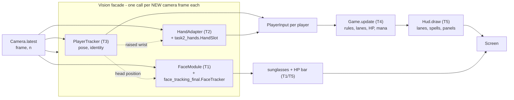
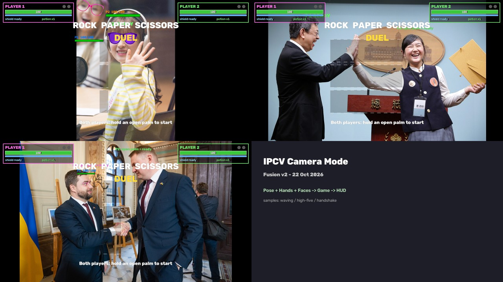

# Fusion v2 — team meeting brief

Status as of 22 Oct 2026. Commit `85154a2` ("Fusion v2: teammates' modules integrated"). 62/62 tests pass.

## What runs today

```bash
cd game
python play_camera.py                       # full pipeline: pose + hands + faces + HUD, two real players
python play_camera.py --solo --level hard    # one real player (always P1) vs. the computer
python play_camera.py --log session.csv      # + per-frame hand metrics (task2_hands.py's own CSV columns)
python play_camera.py --no-glasses --no-hp-bar --every 3 --imgsz 384 --face-every 2   # slower laptop
python play_keyboard.py                      # fallback with no camera/models: keyboard on the webcam picture
python run_on_clip.py --video clip.mp4 --out clip_annotated.mp4   # offline, no camera/bot/keyboard (new, see below)
python benchmark.py --real                   # per-stage ms, CPU and CUDA
pytest .                                     # 62 tests, no camera/GPU/MediaPipe needed
```

Validated live: a `--solo` session on a real webcam + RTX 3050 Ti played a full round with no crash
(cast → counter → hit → K.O. → round 2). **Two real simultaneous players have not been tested live yet**
— see the checklist.

## Pipeline



## Task-by-task

| Task | Teammate's file | How `game/` uses it |
|---|---|---|
| T1 | `face_tracking/face_tracking_final.py` (unchanged) | `face_module.FaceModule` calls its `FaceDetector`/`FaceKalman`/`FaceTracker` directly; links tracks to players by nearest `PlayerTracker` head; drives `draw_hp_bars` from the real game state |
| T2 | `hand_gestures/task2_hands.py` (unchanged) | `hand_adapter.HandAdapter` feeds its `HandSlot` (One Euro, grace frames, confidence) from a MediaPipe `HandLandmarker`; classifies the filtered landmarks fresh each frame |
| T3 | `pose_reid/two_player_pose_tracking_reid.py` (unchanged) | its appearance-cost idea is an additive, **default-off** option on `player_tracker.IdentityManager`; `PlayerTracker` itself is the team's existing pose tracker |
| T4 | `game_logic.py` (pre-existing, untouched) | rules, lanes, HP/mana, phases — no vision library, unaffected by any of this |
| T5 | `vision.py`, `play_camera.py`, `camera.py`, `hud.py` (pre-existing `camera.py`/`hud.py` untouched) | the facade + camera loop + the new `run_on_clip.py` offline harness |

### Requirement coverage (`IPCV Project - Requirements Specification.md`)

Legend: ✅ done · 🟡 partial · ❌ missing. Evidence = test name, a measured number, or "not yet validated".

| ID | Status | Evidence |
|---|---|---|
| T1-01..06, 08, 09 | ✅ | `FaceKalman`/`FaceTracker` state, relinked by head each frame, real HP bar — see `game/README.md`'s T1 row-by-row table |
| T1-07 | 🟡 | coasts + recovers a **frontal** face within ~3 frames (`test_face_tracker_recovers_a_frontal_face_from_a_real_group_photo`); **misses small/partial faces on the full frame** (checklist #2) |
| T2-01, 03–07 | ✅ | `HandSlot` filtering reused unmodified; `GESTURE_TO_ACTION` mapping; see `game/README.md`'s T2 table |
| T2-02 | ❌ | **`HandAdapter` drops a hand when 3+ are visible** — `task2_hands.assign()` keeps only the 2 left-most; P2 loses their gesture while P1 shows both hands (checklist #1, reproduced with 3 and 4 hands) |
| T2-08 | 🟡 | per-call ms measured (`benchmark.py --real`); no real-session jitter number from `--log`'s CSV yet |
| T3-01–07 | ✅ | `test_player_tracker.py` (10 tests): new id, left=P1, re-entry, spectator ignored, crossing with kept ids, solo always P1 |
| T3-08, 09 | 🟡 | `distance_m` is a rough shoulder-width estimate, not calibrated; no explicit uncertainty reporting |
| T3-10 | 🟡 | synthetic tests only; **live two-person crossing/occlusion/re-entry not yet run** (checklist §3) |
| T4-01–09 | ✅ | `test_game_logic.py` (23 tests, pre-existing, untouched) |
| T5-02, 03, 04, 07 | ✅ | `play_camera.py` runs all five tasks together; `benchmark.py --real` identifies hands (~11 ms) and faces (~4–8 ms) as the costliest stages |
| T5-05 | 🟡 | `FaceModule.update()` does **not** clamp `dt` the way `face_tracking_final.main()` does — first-frame/stall `dt` is unbounded (checklist #3) |
| T5-06, 08 | 🟡 | now measured on real people (see still-photo table below): **~14 FPS worst case**, under the ~25 FPS target; not yet improved |
| T5-09 | ❌ | **not yet tested with two real simultaneous players** — only solo, live |
| T5-10 | ✅ | pause on lost presence, no gesture → no action, graceful degradation when a model/asset is missing |

## Still-photo check (samples 03, 05, 06; 1280×720 letterboxed, 20 settle frames, CUDA pose)



| Sample | pose ms (mean/p95) | hands ms | faces ms | drawing ms | glasses shown? |
|---|---|---|---|---|---|
| 03 waving | 8.6 / 9.1 | 19.3 / 20.3 | 34.5 / 36.5 | 2.0 / 2.5 | yes |
| 05 high-five (2 people) | 9.0 / 9.9 | 18.8 / 20.0 | 19.7 / 31.7 | 1.3 / 1.6 | no (see issue 2) |
| 06 handshake (2 people) | 8.8 / 9.5 | 18.6 / 19.7 | 25.7 / 42.6 | 1.4 / 1.7 | no (see issue 2) |
| pose, sample 05, **CPU** (vs. 9.0 ms CUDA above) | 22.4 / 26.6 | — | — | — | — |

**This confirms checklist issue #4, worse than our earlier estimate**: these are *real* people in frame
(the solo-only ~4 ms faces / ~11 ms hands numbers in `game/README.md` were measured against an **empty**
background, where both models return a fast negative). Worst case here (sample 06): 9.5 + 19.7 + 42.6 +
1.7 ≈ **73 ms/frame ≈ 14 FPS** with CUDA pose already applied — well under the ~25 FPS target. Faces are
now clearly the single biggest cost, not hands.

The contact sheet's top-right and bottom-left panels also show checklist issue 5 live: the LOBBY title
text overlaps the player panels' HP bars.

## Known issues (full detail: `Fusion v2 - Checklist.md`)

1. **P2's hand can be dropped** with 3+ visible hands — `task2_hands.assign()`'s own placeholder keeps
   only the 2 left-most detections, with no player-identity awareness.
2. **Small/partial faces on the full frame are missed** (e.g. `samples/04_arms_raised_stage.jpg`) — the
   short-range detector needs a size-appropriate crop, not just the half-frame fallback already in place.
3. `FaceModule.update()`'s `dt` isn't clamped — a stall could hand the Kalman filter an unbounded `dt`.
4. **Two-person performance is measured now, and it's below target** — ~14 FPS worst case on real
   people (see the still-photo table above), vs. the README's ~38 FPS solo/empty-background number.
   Faces are the biggest single cost (up to 42.6 ms p95).
5. The over-head HP label overlaps the LOBBY title.

None of these are fixed yet — by request, so the whole team sees the real current state before any more
changes land.

## Decisions needed

- **Shield / potion gesture**, or keep them keyboard-only.
- **Sunglasses image licence** — confirm provenance before the graded submission.
- **Demo laptop + its Python/MediaPipe environment** — confirmed only on this dev machine (Python 3.14,
  MediaPipe 1.0.1) so far.
- Whether to enable `appearance=True` (T3 re-ID) by default once validated, or keep it opt-in.
- Owner name per module, for the report and README (currently blank in the Requirements doc's table).

## One ask per task

- **T1:** confirm the sunglasses licence, and whether a missed/late glasses appearance on turn-away is
  acceptable for the demo, or needs the ROI-seeded fix from the checklist first.
- **T2:** bring a laptop/webcam for a live 3–4 hand test this week — issue #1 needs to be seen, not just
  read about, before prioritising the fix.
- **T3:** pick a short real clip (or the one specified in the checklist's live-test script) to validate
  `appearance=True` against before deciding whether to turn it on.
- **T4:** nothing blocking — confirm SHIELD/POTION stay keyboard-only for the demo.
- **T5:** decide the performance target for the *real* demo scenario (how many people, how many hands
  visible at once) so issue #4 has a concrete number to hit.
