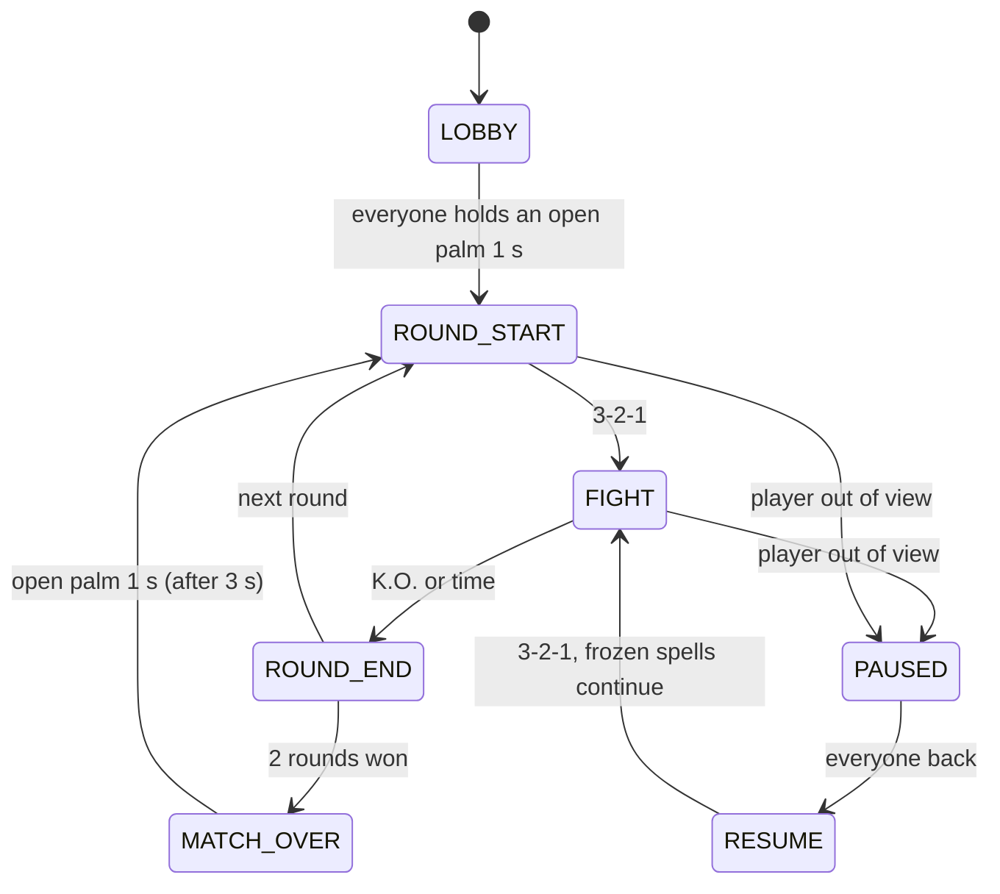

# Rock-paper-scissors duel · game mechanics (T4)

A **real-time** rock–paper–scissors fight in **rounds**, with **three lanes** between the two players.
Everything is drawn **on the camera image** (augmented reality): lanes, flying rocks / paper / scissors, HP.
This folder holds the rules, the round logic and the on-screen feedback, **without any image processing**.
It runs today with the keyboard on top of the webcam picture; the hand / player tracking later replaces the keyboard
without changes to the game code.

`simulated_game.mp4` shows one scripted match (60 s, regenerated 22 Oct 2026 after the shield was dropped) on a
real picture of a room.

---

## Rules

| | |
|---|---|
| **Spells** | Fist = **ROCK** · open palm = **PAPER** · index + middle finger = **SCISSORS** |
| **Lanes** | three horizontal lanes between the players (top, middle, bottom). **The height of your casting hand chooses the lane.** |
| **Casting** | a gesture held for 4 frames launches it into your lane; it travels **slowly** (~3.5 s) to the other side |
| **Spells meet** | in the **same lane**: Paper wraps Rock · Scissors cut Paper · Rock smashes Scissors. The winner goes on, the loser is destroyed; equal spells destroy each other. Spells in **different lanes** pass each other. |
| **Hit** | a spell that reaches the end of its lane, uncountered, hits the opponent (−25 HP; 4 hits = K.O.) |
| **Potion** | +20 HP, once per round (a real bottle or cup at the mouth, if we detect it) |
| **No spamming** | a spell costs 30 mana (100 max, +15 per second); 0.8 s between two spells; holding a gesture casts once: change the gesture to cast again |
| **Rounds** | "ROUND 1 · 3-2-1 · FIGHT!" → fight until K.O. (or 90 s: more HP wins) → **best of 3** wins the match |
| **Start / restart** | both players hold an open palm for 1 s |
| **Player lost** | out of view > 0.4 s → **PAUSE**, spells freeze in their lanes → back → 3-2-1 → the fight continues |

So you play **in time** (answer a spell before it arrives) and **in space** (put your counter in the right
lane). There is no shield (dropped, 22 Oct 2026 team decision) - countering in the same lane is the only defence.

---

## Phases



---

## How it covers the T4 requirements

| Req. | How |
|---|---|
| T4-01 mappings | gesture → spell (`GESTURE_TO_ACTION`), **hand height → lane**; open palm = "ready" in the lobby, PAPER in a fight |
| T4-02 ≥ 2 actions | 3 spell gestures (rock / paper / scissors) + lane choice + potion |
| T4-03 interaction | spells clashing/countering in the lanes (player–player); potion with a real object (player–object, camera trigger pending) |
| T4-04 no repeated actions | only a **change** of stable gesture is a command; cooldown; gestures held during a countdown do not fire |
| T4-05 thresholds / confirmation | 4 equal frames; mana; cooldown — all in `Config` |
| T4-06 per player | all state in `players[id]` |
| T4-07 feedback | ring on each casting hand with the recognised gesture and the cooldown, spells in the lanes, HIT / counter texts, a text feed of what happened |
| T4-08 alignment | spells start at the caster's hand, in the lane of the hand, and end at the opponent's position (T3) |
| T4-09 simultaneous | spells meet in the lanes (counter / clash); deterministic every frame |
| T5-10 failures | player lost → pause with frozen fight; unknown gesture or missing module → no action, never a random spell |

---

## Run

Needs `opencv-python` and `numpy` (the game logic itself needs nothing).

```bash
python test_game_logic.py           # 23 tests: lanes, counters, spam, mana, pause, rounds, bot, ...
python play_keyboard.py             # keyboard game on the webcam picture (--no-camera: plain background)
python play_keyboard.py --solo      # single player: you (left) against the computer (right)
python play_keyboard.py --solo --level hard     # easy | normal | hard
python simulate.py                  # scripted match on assets/demo_background.jpg -> simulated_game.mp4
python simulate.py --background clip.mp4   # the same on any picture or video
python play_camera.py               # T1+T2+T3 fused: pose tracking, hand gestures, face tracking + sunglasses + HP bar
python play_camera.py --solo --level hard             # you are always player 1, even standing right of centre
python play_camera.py --no-glasses --no-hp-bar
python play_camera.py --every 3 --imgsz 384 --face-every 2   # a slower laptop
python play_camera.py --log session.csv               # per-frame hand metrics (task2_hands.py's own CSV columns)
```

Keyboard: **P1** A rock · S paper · D scissors · G potion · Q / W / E lane ·
**P2** J · K · L · N · U / I / O · 1 / 2 = player leaves / comes back.
In keyboard mode the players are virtual (thin outlines at fixed places); with tracking the real players are used.

| File | What |
|---|---|
| `game_logic.py` | rules, lanes, phases, per-player state. **No OpenCV.** |
| `hud.py` | everything drawn on the camera image (lanes, rock / paper / scissors with glow, rings, bars, texts) |
| `play_keyboard.py` | keyboard version on the webcam picture; `--solo` = against the computer |
| `bot.py` | the computer opponent of the single-player mode |
| `simulate.py` | plays a fixed script and saves a video |
| `benchmark.py` | milliseconds per stage of a frame (for the T5 profiling table) |
| `camera.py` | webcam reader: own thread, 30 FPS in a dim room, settings restored at the end |
| `camera_check.py` | measures how many FPS the webcam really gives in each mode |
| `test_game_logic.py` | tests (`python test_game_logic.py` or `pytest`) |
| `assets/demo_background.jpg` | a frame of our own footage, background of the simulation |
| `vision.py` | the fused camera pipeline: owns `PlayerTracker` + `HandAdapter` + `FaceModule`, one call each per *camera* frame |
| `hand_adapter.py` | MediaPipe hands -> `../hand_gestures/task2_hands.py`'s `HandSlot` filtering (unmodified) -> gesture + player |
| `face_module.py` | `../face_tracking/face_tracking_final.py`'s `FaceDetector`/`FaceKalman`/`FaceTracker` (unmodified), linked to players |
| `play_camera.py` | camera version: pose + hand + face tracking instead of the keyboard, `--solo` against the computer too |
| `test_vision.py`, `test_face_module.py` | tests of the fusion (gesture classifier, assignment, call counts, import hygiene) |
| `models/face_landmarker.task` | MediaPipe FaceLandmarker model (downloaded; see "Fusing the group's submitted code") |

### Single-player mode (`--solo`)

The computer plays player 2 (shown as **CPU**). It uses **the same input as a person** — every frame a gesture and a
hand lane — so it obeys the same rules (stable frames, change the gesture to cast again, cooldown, mana). It sees
the spells coming at it and, after a human-like reaction time, answers with the winning spell in the same lane
(its only defence now - the shield was dropped, 22 Oct 2026 team decision); it attacks at random moments in random
lanes and drinks its potion when it is hurt. Re-measured after the shield's removal, 5 games per level (a player
casting a random spell every 2.4 s):

| Level | Spells it answers | Match win rate |
|---|---|---|
| easy | 31 % | 3 / 5 |
| normal | 57 % | 5 / 5 |
| hard | 66 % | 5 / 5 |

Lower "spells it answers" than before the shield was dropped (was 38/70/76 %) - expected: countering needs the
spell to still be far enough away when the bot reacts, a strictly tighter window than shield's "block in time
*or* counter" used to allow. Win rate is barely affected, since the bot's own attacks are unchanged.

With the tracking plugged in it works the same way: player 1 comes from the camera, player 2 from `Bot.act()`.

### Speed

`python benchmark.py` times every stage of a frame (scripted match, 1280×720, no window). Laptop CPU, 13 Oct:

| Stage | Before | After | What changed |
|---|---|---|---|
| darken the camera picture | 13.0 ms | 0.5 ms | 8-bit OpenCV maths (`cv2.convertScaleAbs`) instead of numpy floats |
| drawing (mean / 95th pct.) | 10.0 / 20.7 ms | 2.5 / 3.6 ms | glow layer at half resolution; lane dashes computed once and drawn in one call; same fast darkening for lanes, panels and pause screens |
| game logic | 0.05 ms | 0.05 ms | — |
| **total per frame** | **23.7 ms** (max 42 FPS) | **3.7 ms** (max 270 FPS) | at 960×540: 2.4 ms |

The picture looks the same (mean difference 1 grey level per pixel). The keyboard loop also waits 1 ms instead of
10 ms for keys, shows **FPS, camera FPS and game ms** in the bottom-right corner, and accepts `--size 960x540`.

### The webcam was the real bottleneck

The laptop was hardly working, yet the game felt slow: **the webcam gave only 10 FPS** — in every format and size
(`python camera_check.py`). In a dim room auto exposure makes every picture 100 ms long, so the camera slows down.

| Webcam setting (evening, room light) | FPS | Mean brightness |
|---|---|---|
| auto exposure (OpenCV default) | 10.0 | 116 |
| fixed exposure 30 ms | 30.0 | 48 (too dark) |
| **fixed exposure 30 ms + gain ~90** (`camera.py`, default) | **29.9** | 101 |

`camera.py` sets this up (MJPG, exposure 30 ms, gain adjusted slowly to keep the brightness), reads the camera in
its own thread so the game never waits for it (drawing runs at ~60 FPS, measured 52 FPS average with the webcam),
and puts the camera back on auto exposure when the game ends — V4L2 settings would otherwise stay.
Note: `CAP_PROP_BUFFERSIZE = 1` made it worse (18 FPS: with one buffer the camera waits for the program), so the
thread empties the queue instead. `--cam-auto` keeps the camera on auto exposure.
For the demo: more light in the room also helps (less gain = less noise for the hand detector).

---

## Player tracking for the game (T3 proposal): `player_tracker.py`

Based on the team's `two_player_pose_tracking.py` (YOLOv8n-pose + ByteTrack), cut down to what the game uses:

| The game needs, per player | For | Precision / rate needed |
|---|---|---|
| present | pause after 0.4 s without | ~10 Hz |
| head position | HUD, end of the lanes | ± 30 px, 10–15 Hz |
| wrists | which hand belongs to whom; the raised wrist picks the lane | ± 40 px (a lane is ~115 px), 15 Hz |
| identity: left = PLAYER 1 | panels, lane direction | must never change in normal play |

| Change | Measured (cloud CPU, 2 cores; the i5 laptop is faster, the RTX 3050 Ti much faster) |
|---|---|
| input 480 instead of 640 | 69 → 41 ms per run; head moves ~5 px, wrists ~20 px vs 640 |
| pose model on every 2nd frame | 41 → 21 ms per frame on average |
| only the 2 biggest people | spectators behind the players are ignored |
| identities fixed | on our own footage: always PLAYER 1 through 3 tracker ids (the original: 1 → 2 → 2 → 1) |
| ByteTrack keeps lost tracks 60 frames | fewer new ids after an occlusion |

`python test_player_tracker.py` (8 tests: new tracker id, left = P1, re-entry, spectators, crossing) needs no camera
or YOLO. The tracker itself needs `pip install ultralytics lap` (PyTorch comes with it, ~2–3 GB; with CUDA:
`PlayerTracker(device="cuda")`). Demo: `python player_tracker.py` (webcam) or `--video clip.mp4`.
`tracker.game_input(pid, gesture)` gives the `PlayerInput` for the game.

---

## Connecting the vision modules (T2, T3, T5)

Per frame and per player ID the game needs: in view?, gesture, hand position, head / torso position.

```python
from game_logic import Game, PlayerInput
from hud import Hud

game, hud = Game([1, 2], frame_size=(1280, 720)), Hud()
while True:
    frame, t_ms = camera.read()                       # mirrored webcam picture, t_ms = frame time
    players = tracker.update(frame)                   # T3: {id: player}, with T2's gesture per player
    inputs = {pid: PlayerInput(present=p.status == "ok",
                               gesture=p.gesture,     # "ROCK" | "PAPER" | "SCISSORS" | "POTION" | None
                               hand_xy=p.hand_xy,     # pixels: the casting hand (its height = the lane)
                               body_xy=p.face_xy)     # pixels: head or torso, where the lanes end
              for pid, p in players.items()}
    events = game.update(t_ms, inputs)
    snap = game.snapshot()
    hud.add(events, t_ms, snap)
    hud.draw(frame, snap, t_ms)                       # draws on the camera picture
```

- **Gesture names**: `ROCK`, `PAPER`, `SCISSORS` (also lower case). The names of the first hand script (`FIRE`, `WATER`, `LIGHTNING`) are still accepted. Anything else = no action.
- **Lane heights** are fixed on the screen (`Config.lanes`, now 36 %, 54 %, 72 % of the height) and drawn, so players see where to hold the hand. Adjust them to where hands are when people stand 1.5–2 m from the camera.
- `events` tell T1 / T5 what to show: `cast`, `hit`, `counter`, `clash`, `heal`, `invalid`, `ko`, `phase`, `tick`, `aim`. Example for the scene: on `hit` → shake or flash the side of the player who was hit.
- `game.snapshot()["spells"]` gives every spell's lane and position each frame.

---

## Fusing the group's submitted code: `vision.py`

The three files each teammate submitted (`code pieces/OneDrive_1_10-21-2026.zip`) live **unchanged**, under
their own names, next to the game: [`../face_tracking/face_tracking_final.py`](../face_tracking/face_tracking_final.py),
[`../hand_gestures/task2_hands.py`](../hand_gestures/task2_hands.py),
[`../pose_reid/two_player_pose_tracking_reid.py`](../pose_reid/two_player_pose_tracking_reid.py) (plus the two
sunglasses JPGs, next to `face_tracking_final.py`, exactly where it already expects them). `game/` **imports and
calls their real classes** - it does not re-implement what they do. `vision.py` is the facade that owns all of
it: one `PlayerTracker` (pose), one `HandAdapter` (wrapping MediaPipe + `task2_hands.py`'s `HandSlot`), one
`FaceModule` (wrapping `face_tracking_final.py`'s `FaceDetector` / `FaceKalman` / `FaceTracker`). Each runs **at
most once per *camera* frame** (`Vision.process(frame, t_ms, n)`, `n` = `Camera.latest()`'s own frame counter;
the render loop can run faster than the camera's 30 FPS, and used to re-run every model on a repeated picture).
`game_logic.py`, `hud.py`, `play_keyboard.py`, `simulate.py` and `bot.py` are untouched - `PlayerInput` is still
the only contract between vision and the game.

Needs `pip install -r requirements-vision.txt` (mediapipe, ultralytics, lap) on top of the base
`opencv-python` / `numpy` the rest of `game/` uses. `pytest game/` passes with none of that installed (lazy
imports everywhere; fakes injected in the tests) - confirmed on both the plain interpreter and a venv with the
real packages.

| Group's file | Reused as | What `game/` adds around it (the file itself is untouched) |
|---|---|---|
| `face_tracking_final.py` | `face_module.FaceModule` | passes `game/models/face_landmarker.task` to `FaceDetector` directly (instead of the file's own hardcoded `C:\cvdata\...` constant, which is simply never read); links each `FaceTracker` track to a **player id** by nearest `PlayerTracker` head (the file's own track ids come from its own appearance re-ID and can disagree with the pose identity); calls `draw_sunglasses`/`draw_hp_bars` unmodified, with a `game_state` built fresh each frame from the real `game.snapshot()` instead of the file's own key-press test damage; an optional every-Nth-frame detect cadence, letting `FaceTracker`'s own coasting (`predict()` + `mark_missed()`, already in the file) fill the gap |
| `task2_hands.py` | `hand_adapter.HandAdapter` | feeds its `HandSlot` (One Euro filter, grace frames, jump rejection, min confidence) from a MediaPipe `HandLandmarker` (Task API: the file's own `mp.solutions.hands` detector no longer exists in any MediaPipe build with Python 3.14 wheels - see "MediaPipe `mp.solutions`" below); classifies the *filtered* landmarks fresh every frame rather than using the file's own hold-to-confirm, since `game_logic`'s `stable_frames` debounce already does that job (stacking both would add a second delay); assigns the result to a player by nearest *raised* wrist, replacing the file's own left/right placeholder (its own docstring: "placeholder for Task 3 identity tracking") |
| `two_player_pose_tracking_reid.py` | `player_tracker.IdentityManager(appearance=True)` | its appearance/motion/pose cost is an **additive, default-off** option on the existing identity matcher, not a second tracker; off by default because it is unvalidated on real two-player footage (see Risks) |
| `hand_detection/detect_hands.py`, `two_player_pose_tracking.py` (already in the repo) | not reused for the camera mode | **not marked deprecated** - both stay exactly as the team wrote them, including their own `main()` and docs; `game/` simply doesn't call either |

### MediaPipe's `mp.solutions` (why `hand_adapter.py` has a shim, and `task2_hands.py` doesn't run standalone here)

`mp.solutions.hands` - what `task2_hands.py` imports at module level - was removed from MediaPipe before
MediaPipe shipped a Python 3.14 wheel (checked: 0.10.30 through 1.1.1, the only versions with cp314 wheels,
all lack `mp.solutions`; this machine runs 3.14). There is **no installable MediaPipe version** on this Python
where the unmodified file would otherwise import. `hand_adapter._th()` installs a two-line shim
(`mp.solutions.hands.HAND_CONNECTIONS`, the one symbol the file reads at import time, only to build a drawing
helper this module never calls) before importing it - the file itself is never touched. The consequence: running
`python hand_gestures/task2_hands.py` directly (its own webcam demo) will still fail on this Python; only the
pure logic this module imports (`HandSlot`, `OneEuro`, `assign`) is exercised, which needs no live detector.

### Bug fixes from a live run

A real two-player/solo test surfaced two bugs no unit test had caught:
- **`--solo` could hand the human's slot to the bot.** `IdentityManager`'s "first time: left = P1, right = P2"
  rule means a lone player standing right of centre got assigned P2 - the slot `play_camera.py` always
  overwrites with the bot's own input, silencing the real person. Fixed with `IdentityManager(solo_pid=1)`:
  in solo mode the *first* detection always becomes P1, and a bystander is never mistaken for P2 (tests:
  `test_player_tracker.py::test_solo_*`).
- **The pose model re-ran on repeated camera frames.** `Vision.process`'s frame-dedup (`n` from
  `Camera.latest()`) only covered the hand model; pose re-ran every render tick even when the camera hadn't
  produced a new picture yet. Now both (and faces) are skipped together on a repeated `n`
  (`test_vision.py::test_vision_does_not_rerun_hands_or_faces_on_the_same_camera_frame_number`).

### T1 / T2 requirement coverage

Against `IPCV Project - Requirements Specification.md`'s own IDs:

| ID | How |
|---|---|
| T1-01 detect ≥ 2 faces | `FaceTracker`'s `MAX_FACES = EXPECTED_FACES = 2`, unmodified |
| T1-02 location/size/orientation over time | `FaceKalman`'s `(cx, cy, r, roll)` state, unmodified |
| T1-03 temporal filtering | `FaceKalman` itself *is* the filter (constant-velocity Kalman), unmodified |
| T1-04 an effect on each face | sunglasses, via `draw_sunglasses` |
| T1-05 aligned through movement/turn/distance | the Kalman state drives the affine warp every frame, unmodified |
| T1-06 no switching between players | tracks are relinked to a **player id** by nearest head every frame, not kept on `FaceTracker`'s own (re-ID-derived) track id |
| T1-07 short failures / partial occlusion | `FaceTracker`'s own coasting (`LOST_TIMEOUT=0.8s`, `mark_missed`) + the measured half-frame-search recovery (see Risks); degrades to "no glasses for that player", never a crash |
| T1-08 one extra effect, different from the face effect | the HP bar (`draw_hp_bars`), above the head |
| T1-09 a meaningful role, not static | the bar reads the real `hp`/`max_hp` from `game.snapshot()` and flashes on a real `hit` event |
| T2-04 temporal filtering/smoothing | `HandSlot`'s One Euro filter, unmodified |
| T2-05 confidence to flag unreliable keypoints | `HandSlot.update`'s `MIN_CONF` gate, unmodified |
| T2-06 missing keypoints, no uncontrolled actions | `HandSlot`'s `GRACE_FRAMES` hold-then-reset, unmodified; an unassigned hand simply gives no gesture |
| T2-07 smoothness vs. responsiveness | One Euro's adaptive cutoff (unmodified) + classifying every frame fresh, instead of stacking the file's own hold-to-confirm on top of `game_logic`'s debounce |
| T2-08 evaluate responsiveness/stability | `benchmark.py --real`'s per-stage ms (below) + `--log`'s CSV (raw vs. filtered wrist, confidence, latency columns) for a real-session measurement |

### Measured performance (RTX 3050 Ti laptop, `python benchmark.py --real`, 1280×720)

| Stage | CPU | CUDA |
|---|---|---|
| pose (YOLOv8n-pose, every 2nd frame) | 20.3 ms mean / 21.7 ms p95 | **7.0 ms** mean / 8.2 ms p95 |
| hands (MediaPipe HandLandmarker, every frame) | 11.0 ms mean / 12.2 ms p95 | not attempted (see below) |
| faces (MediaPipe FaceLandmarker, every frame) | 4.1 ms mean / 7.5 ms p95 | not attempted (see below) |
| game + HUD + hand assignment (no vision) | 3.9 ms mean / 5.4 ms p95 | same (CPU-only) |

Naively running every model every frame: **CPU ≈ 39 ms/frame (≈ 25 FPS)**, right at the ~25 FPS / p95 50 ms
proposal; **with CUDA for pose ≈ 26 ms/frame (≈ 38 FPS)**, comfortably inside it. A live `--solo` run (webcam,
CUDA pose) played a full round with no crash and no perceptible lag, consistent with these numbers.
MediaPipe's GPU delegate needs extra OpenGL/EGL setup this project does not attempt, so hands/faces are CPU
(XNNPACK) only here; CUDA only speeds up the YOLO pose stage.

### Known risks and what is still unvalidated

- **Face detection shrinks away on a full 1280-wide frame.** Measured directly (`hand_detection/samples/05_high_five_two_people.jpg`,
  two real faces, ~150-200 px wide in a 1280 px frame): a raw `FaceLandmarker.detect()` call on the full image
  finds **zero** faces, even at `min_face_detection_confidence=0.1`; the same model finds the same face
  immediately on a tight crop around it. This is a real limitation of MediaPipe's short-range face detector at
  this face-to-frame ratio, not a bug in this integration. **`face_tracking_final.py`'s own unmodified recovery
  mechanism already handles it**: `FaceTracker.step()`'s half-frame search (`SEARCH_EVERY=3`) found the frontal
  face within 3 calls (~100 ms at 30 FPS) in the same test photo (`test_face_module.py::test_face_tracker_recovers_a_frontal_face_from_a_real_group_photo`).
  The **profile-oriented** face in the same photo was never confirmed across 12 calls - a known weak point of
  this face detector for non-frontal faces, not something to chase further here. Expect a similar few-frame
  delay before glasses first appear in real play, and no glasses at all while a player is turned away from the
  camera (a controlled failure, not a crash - satisfies T1-07, just not with instant recognition).
- **Only solo mode has been run against a real camera.** A live `--solo` session (one real person vs. the bot)
  played cleanly through a full round. **Two real simultaneous players, crossing, and re-entry after leaving
  the frame have not been tested live** - only exercised through `test_player_tracker.py`'s synthetic
  identity-manager scenarios.
- **The One Euro filter's actual jitter reduction is unmeasured on live video.** `HandSlot`'s filtering is
  reused unmodified and is exercised by `test_face_module.py`/`test_vision.py` with synthetic landmarks, but no
  raw-vs-filtered jitter number from `--log`'s CSV has been computed from a real session yet (T2-04's metric).
- **Re-ID (`appearance=True`) is unvalidated.** `test_player_tracker.py` passes unchanged with it off (the
  default); nobody has checked it against real two-player footage, crossing or otherwise.
- **MediaPipe on Python 3.14 generally.** This machine runs 3.14 with MediaPipe 1.0.1 (the exact pin in
  `hand_detection/requirements.txt`) - confirm this installs on the actual demo laptop before relying on it.
- **Sunglasses asset licence.** `sunglasses_picture.jpg` / `sunglasses_picture2.jpg` (now canonically in
  `../face_tracking/`, next to the code that loads them) - confirm their provenance before this goes into a
  graded deliverable.

## To decide as a team

- [x] **Shield**: dropped (team decision, 22 Oct 2026). Countering in the same lane is the only defence now.
- [ ] **Potion**: kept - camera trigger still pending (object detector for bottle/cup + mouth position, or a
     dedicated gesture - and who builds it). Keyboard-only (P1 G, P2 N) until then.
- [ ] **Lane heights and speed** with real players in front of the demo laptop.
- [ ] **Numbers** after a few real games: damage, mana, cooldown, speed (`Config`).
