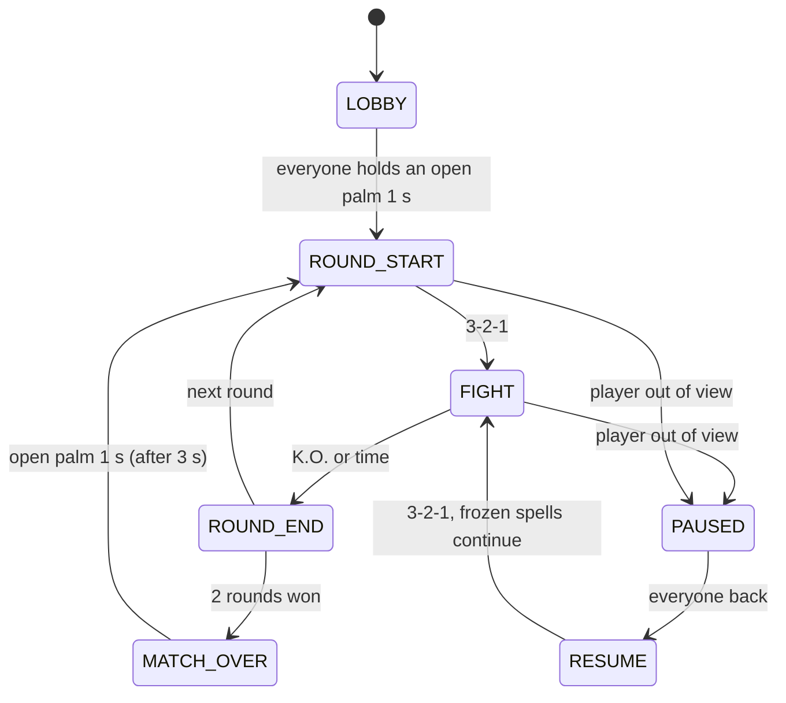

# Rock-paper-scissors duel · game mechanics (T4)

A **real-time** rock–paper–scissors fight in **rounds**, with **three lanes** between the two players.
Everything is drawn **on the camera image** (augmented reality): lanes, flying rocks / paper / scissors, shields, HP.
This folder holds the rules, the round logic and the on-screen feedback, **without any image processing**.
It runs today with the keyboard on top of the webcam picture; the hand / player tracking later replaces the keyboard
without changes to the game code.

`simulated_game.mp4` shows one scripted match (62 s) on a real picture of a room.

---

## Rules

| | |
|---|---|
| **Spells** | Fist = **ROCK** · open palm = **PAPER** · index + middle finger = **SCISSORS** |
| **Lanes** | three horizontal lanes between the players (top, middle, bottom). **The height of your casting hand chooses the lane.** |
| **Casting** | a gesture held for 4 frames launches it into your lane; it travels **slowly** (~3.5 s) to the other side |
| **Spells meet** | in the **same lane**: Paper wraps Rock · Scissors cut Paper · Rock smashes Scissors. The winner goes on, the loser is destroyed; equal spells destroy each other. Spells in **different lanes** pass each other. |
| **Hit** | a spell that reaches the end of its lane hits the opponent (−25 HP; 4 hits = K.O.) |
| **Shield** | hold the shield gesture with your hand at a lane: it blocks that lane, at most 2 s, then 4 s to recharge |
| **Potion** | +20 HP, once per round (a real bottle or cup at the mouth, if we detect it) |
| **No spamming** | a spell costs 30 mana (100 max, +15 per second); 0.8 s between two spells; holding a gesture casts once: change the gesture to cast again |
| **Rounds** | "ROUND 1 · 3-2-1 · FIGHT!" → fight until K.O. (or 90 s: more HP wins) → **best of 3** wins the match |
| **Start / restart** | both players hold an open palm for 1 s |
| **Player lost** | out of view > 0.4 s → **PAUSE**, spells freeze in their lanes → back → 3-2-1 → the fight continues |

So you play **in time** (answer a spell before it arrives) and **in space** (put your counter or your shield in the right lane).

---

## Phases



---

## How it covers the T4 requirements

| Req. | How |
|---|---|
| T4-01 mappings | gesture → spell (`GESTURE_TO_ACTION`), **hand height → lane**; open palm = "ready" in the lobby, PAPER in a fight |
| T4-02 ≥ 2 actions | 3 spells, choice of lane, shield, potion |
| T4-03 interaction | spells fight each other in the lanes (player–player); potion with a real object (player–object) |
| T4-04 no repeated actions | only a **change** of stable gesture is a command; cooldown; gestures held during a countdown do not fire |
| T4-05 thresholds / confirmation | 4 equal frames; mana; cooldown; shield duration and recharge — all in `Config` |
| T4-06 per player | all state in `players[id]` |
| T4-07 feedback | ring on each casting hand with the recognised gesture and the cooldown, spells in the lanes, shields, HIT / BLOCKED / counter texts, a text feed of what happened |
| T4-08 alignment | spells start at the caster's hand, in the lane of the hand, and end at the opponent's position (T3) |
| T4-09 simultaneous | spells meet in the lanes (counter / clash); deterministic every frame |
| T5-10 failures | player lost → pause with frozen fight; unknown gesture or missing module → no action, never a random spell |

---

## Run

Needs `opencv-python` and `numpy` (the game logic itself needs nothing).

```bash
python test_game_logic.py           # 23 tests: lanes, counters, shields, spam, mana, pause, rounds, bot, ...
python play_keyboard.py             # keyboard game on the webcam picture (--no-camera: plain background)
python play_keyboard.py --solo      # single player: you (left) against the computer (right)
python play_keyboard.py --solo --level hard     # easy | normal | hard
python simulate.py                  # scripted match on assets/demo_background.jpg -> simulated_game.mp4
python simulate.py --background clip.mp4   # the same on any picture or video
python play_camera.py               # T2+T3+AR fused: pose tracking + hand gestures + sunglasses overlay
python play_camera.py --solo --level hard
python play_camera.py --no-glasses --every 3 --imgsz 384   # a slower laptop
```

Keyboard: **P1** A rock · S paper · D scissors · F shield · G potion · Q / W / E lane ·
**P2** J · K · L · H · N · U / I / O · 1 / 2 = player leaves / comes back.
In keyboard mode the players are virtual (thin outlines at fixed places); with tracking the real players are used.

| File | What |
|---|---|
| `game_logic.py` | rules, lanes, phases, per-player state. **No OpenCV.** |
| `hud.py` | everything drawn on the camera image (lanes, rock / paper / scissors with glow, shields, rings, bars, texts) |
| `play_keyboard.py` | keyboard version on the webcam picture; `--solo` = against the computer |
| `bot.py` | the computer opponent of the single-player mode |
| `simulate.py` | plays a fixed script and saves a video |
| `benchmark.py` | milliseconds per stage of a frame (for the T5 profiling table) |
| `camera.py` | webcam reader: own thread, 30 FPS in a dim room, settings restored at the end |
| `camera_check.py` | measures how many FPS the webcam really gives in each mode |
| `test_game_logic.py` | tests (`python test_game_logic.py` or `pytest`) |
| `assets/demo_background.jpg` | a frame of our own footage, background of the simulation |
| `vision.py` | the fused camera pipeline: owns `PlayerTracker` + `HandAdapter`, one call each per frame |
| `hand_adapter.py` | hand gesture classification (ported from `task2_hands.py`) + hand-to-player assignment |
| `sunglasses_overlay.py` | the sunglasses AR overlay, from pose eye keypoints (ported from `face_tracking_final.py`) |
| `play_camera.py` | camera version: pose + hand tracking instead of the keyboard, `--solo` against the computer too |
| `test_vision.py` | tests of the fusion (gesture classifier, hand assignment, call counts, import hygiene) |
| `assets/sunglasses_picture.jpg`, `sunglasses_picture2.jpg` | P1 / P2 sunglasses sprites (plain JPGs; keyed to RGBA at load) |

### Single-player mode (`--solo`)

The computer plays player 2 (shown as **CPU**). It uses **the same input as a person** — every frame a gesture and a
hand lane — so it obeys the same rules (stable frames, change the gesture to cast again, cooldown, mana, shield
recharge). It sees the spells coming at it and, after a human-like reaction time, answers with the winning spell in
the same lane or raises a shield just before the spell arrives; it attacks at random moments in random lanes and
drinks its potion when it is hurt. Measured over 5 games per level (a player casting a random spell every 2.4 s):

| Level | Spells it answers | Time to beat a player who does nothing |
|---|---|---|
| easy | 38 % | 46 s |
| normal | 70 % | 38 s |
| hard | 76 % | 31 s |

With the tracking plugged in it works the same way: player 1 comes from the camera, player 2 from `Bot.act()`.

### Speed

`python benchmark.py` times every stage of a frame (scripted match, 1280×720, no window). Laptop CPU, 13 Oct:

| Stage | Before | After | What changed |
|---|---|---|---|
| darken the camera picture | 13.0 ms | 0.5 ms | 8-bit OpenCV maths (`cv2.convertScaleAbs`) instead of numpy floats |
| drawing (mean / 95th pct.) | 10.0 / 20.7 ms | 2.5 / 3.6 ms | glow layer at half resolution; lane dashes computed once and drawn in one call; same fast darkening for lanes, panels and pause screens |
| game logic | 0.05 ms | 0.05 ms | — |
| **total per frame** | **23.7 ms** (max 42 FPS) | **3.7 ms** (max 270 FPS) | at 960×540: 2.4 ms |

The picture looks the same (mean difference 1 grey level per pixel). The keyboard loop also waits 1 ms instead of
10 ms for keys, shows **FPS, camera FPS and game ms** in the bottom-right corner, and accepts `--size 960x540`.

### The webcam was the real bottleneck

The laptop was hardly working, yet the game felt slow: **the webcam gave only 10 FPS** — in every format and size
(`python camera_check.py`). In a dim room auto exposure makes every picture 100 ms long, so the camera slows down.

| Webcam setting (evening, room light) | FPS | Mean brightness |
|---|---|---|
| auto exposure (OpenCV default) | 10.0 | 116 |
| fixed exposure 30 ms | 30.0 | 48 (too dark) |
| **fixed exposure 30 ms + gain ~90** (`camera.py`, default) | **29.9** | 101 |

`camera.py` sets this up (MJPG, exposure 30 ms, gain adjusted slowly to keep the brightness), reads the camera in
its own thread so the game never waits for it (drawing runs at ~60 FPS, measured 52 FPS average with the webcam),
and puts the camera back on auto exposure when the game ends — V4L2 settings would otherwise stay.
Note: `CAP_PROP_BUFFERSIZE = 1` made it worse (18 FPS: with one buffer the camera waits for the program), so the
thread empties the queue instead. `--cam-auto` keeps the camera on auto exposure.
For the demo: more light in the room also helps (less gain = less noise for the hand detector).

---

## Player tracking for the game (T3 proposal): `player_tracker.py`

Based on the team's `two_player_pose_tracking.py` (YOLOv8n-pose + ByteTrack), cut down to what the game uses:

| The game needs, per player | For | Precision / rate needed |
|---|---|---|
| present | pause after 0.4 s without | ~10 Hz |
| head position | HUD, end of the lanes | ± 30 px, 10–15 Hz |
| wrists | which hand belongs to whom; the raised wrist picks the lane | ± 40 px (a lane is ~115 px), 15 Hz |
| identity: left = PLAYER 1 | panels, lane direction | must never change in normal play |

| Change | Measured (cloud CPU, 2 cores; the i5 laptop is faster, the RTX 3050 Ti much faster) |
|---|---|
| input 480 instead of 640 | 69 → 41 ms per run; head moves ~5 px, wrists ~20 px vs 640 |
| pose model on every 2nd frame | 41 → 21 ms per frame on average |
| only the 2 biggest people | spectators behind the players are ignored |
| identities fixed | on our own footage: always PLAYER 1 through 3 tracker ids (the original: 1 → 2 → 2 → 1) |
| ByteTrack keeps lost tracks 60 frames | fewer new ids after an occlusion |

`python test_player_tracker.py` (8 tests: new tracker id, left = P1, re-entry, spectators, crossing) needs no camera
or YOLO. The tracker itself needs `pip install ultralytics lap` (PyTorch comes with it, ~2–3 GB; with CUDA:
`PlayerTracker(device="cuda")`). Demo: `python player_tracker.py` (webcam) or `--video clip.mp4`.
`tracker.game_input(pid, gesture)` gives the `PlayerInput` for the game.

---

## Connecting the vision modules (T2, T3, T5)

Per frame and per player ID the game needs: in view?, gesture, hand position, head / torso position.

```python
from game_logic import Game, PlayerInput
from hud import Hud

game, hud = Game([1, 2], frame_size=(1280, 720)), Hud()
while True:
    frame, t_ms = camera.read()                       # mirrored webcam picture, t_ms = frame time
    players = tracker.update(frame)                   # T3: {id: player}, with T2's gesture per player
    inputs = {pid: PlayerInput(present=p.status == "ok",
                               gesture=p.gesture,     # "ROCK" | "PAPER" | "SCISSORS" | "SHIELD" | "POTION" | None
                               hand_xy=p.hand_xy,     # pixels: the casting hand (its height = the lane)
                               body_xy=p.face_xy)     # pixels: head or torso, where the lanes end
              for pid, p in players.items()}
    events = game.update(t_ms, inputs)
    snap = game.snapshot()
    hud.add(events, t_ms, snap)
    hud.draw(frame, snap, t_ms)                       # draws on the camera picture
```

- **Gesture names**: `ROCK`, `PAPER`, `SCISSORS` (also lower case). The names of the first hand script (`FIRE`, `WATER`, `LIGHTNING`) are still accepted. Anything else = no action.
- **Lane heights** are fixed on the screen (`Config.lanes`, now 36 %, 54 %, 72 % of the height) and drawn, so players see where to hold the hand. Adjust them to where hands are when people stand 1.5–2 m from the camera.
- `events` tell T1 / T5 what to show: `cast`, `hit`, `blocked`, `counter`, `clash`, `shield_up`, `shield_down`, `heal`, `invalid`, `ko`, `phase`, `tick`, `aim`. Example for the scene: on `hit` → shake or flash the side of the player who was hit.
- `game.snapshot()["spells"]` gives every spell's lane and position each frame.

---

## Fusing the group's submitted code: `vision.py`

`play_camera.py` replaces the keyboard with `vision.py`, a facade that is the **only** place that owns a
model: one `PlayerTracker` (pose, its own `every`-frame cadence) and one `HandAdapter` (hands, every
frame). Needs `pip install -r requirements-vision.txt` (mediapipe, ultralytics, lap) on top of the base
`opencv-python` / `numpy` the rest of `game/` uses; `test_vision.py` and the rest of the test suite run
fine without any of them installed (lazy imports, fakes injected in the tests). Each returns at most once per frame; `vision.process(frame, t_ms)` turns their output into the
same `PlayerInput` the keyboard and the bot already feed the game, so `game_logic.py`, `hud.py`,
`play_keyboard.py`, `simulate.py` and `bot.py` did not need to change.

| Group's submitted file (in `code pieces/OneDrive_1_10-21-2026.zip`) | Superseded by | What changed |
|---|---|---|
| `two_player_pose_tracking_reid.py` | `player_tracker.py` (`IdentityManager(appearance=True)`) | the appearance/motion/pose cost is now an **additive, default-off** option on the existing identity matcher, not a second tracker; off by default because it is unvalidated on real footage (see Risks) |
| `task2_hands.py` | `hand_adapter.py` | kept the finger-state classifier (FIRE/WATER/LIGHTNING) and MediaPipe wiring; dropped its own hold-to-confirm and its placeholder left/right hand assignment, since `game_logic`'s `stable_frames` debounce and the real `PlayerTracker` identities already do both, better |
| `face_tracking_final.py` | `sunglasses_overlay.py` | kept `make_transparent` (the background-keying for the alpha-less JPGs) and the eye-line affine warp; dropped the separate face-landmark model, Kalman filter and face re-ID, since the pose keypoints `PlayerTracker` already extracts anchor the glasses with no extra inference |
| `hand_detection/detect_hands.py` (already in the repo) | `hand_adapter.py` | deprecated as live code (`DeprecationWarning` when run directly); the hand_detection write-up and its figures are untouched |
| `two_player_pose_tracking.py` (already in the repo) | `player_tracker.py` / `vision.py` | deprecated as live code (`DeprecationWarning` on import); nothing in `game/` ever imported it |

**Known risks, not yet resolved by a test:**
- **MediaPipe on this Python.** This machine runs Python 3.14; MediaPipe wheels have historically lagged
  new CPython releases. `pip install mediapipe` may simply fail here — check before the demo, on the
  actual demo laptop's Python.
- **Real-camera latency is unmeasured.** `benchmark.py`'s new `hand assignment` / `glasses overlay` rows
  time only the post-processing (no YOLO/MediaPipe installed in this environment); the pose and hand
  model calls themselves still need a real run on the demo hardware.
- **Re-ID (`appearance=True`) is unvalidated.** `test_player_tracker.py` passes unchanged with it off (the
  default); nobody has checked it against real two-player footage yet. Turn it on deliberately, re-run the
  tests, and watch for regressions before relying on it.
- **Sunglasses asset licence.** `sunglasses_picture.jpg` / `sunglasses_picture2.jpg` are copied into
  `game/assets/`; confirm where they came from before this goes into a graded deliverable.

## To decide as a team

- [ ] **Shield gesture**: e.g. **both** palms open, or a "stop" hand. T2 / T3 send `"SHIELD"` for that player.
- [ ] **Potion**: keep it (object detector for bottle / cup + mouth position) or drop it.
- [ ] **Lane heights and speed** with real players in front of the demo laptop.
- [ ] **Numbers** after a few real games: damage, mana, cooldown, speed (`Config`).
